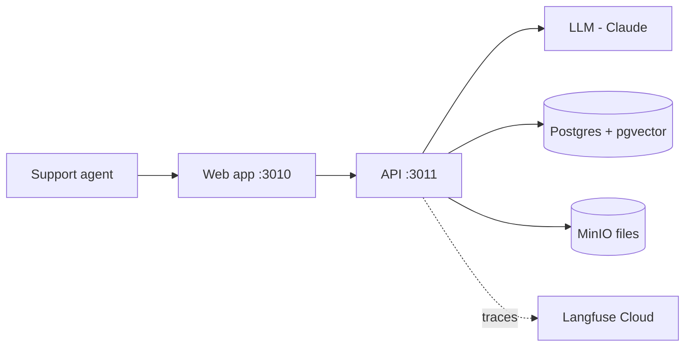

# Learning journal

This folder explains **every step** of building `support-triage-ai`: what we built, why we built it
that way, the problems we hit, how we fixed them, and what an interviewer might ask about it.

Read the steps in order. Each step file has the same sections:

1. **Goal**: what this step is for
2. **What we built**: files and pieces
3. **Why this way**: the design reasons (the most important part for interviews)
4. **How it works**: the flow, step by step
5. **Try it yourself**: commands to run
6. **Problems we faced**: symptom, cause, fix, lesson
7. **Interview questions**: short answers you can say out loud
8. **Key takeaways**

## Steps

| #   | Step                                                                         | Status |
| --- | ---------------------------------------------------------------------------- | ------ |
| 00  | [Project skeleton (monorepo, TypeScript, lint)](00-project-skeleton.md)      | Done   |
| 01  | [Configuration and secrets (.env + Zod)](01-configuration-and-env.md)        | Done   |
| 02  | [Local infrastructure: Docker, Postgres, MinIO](02-docker-postgres-minio.md) | Done   |
| 03  | [Observability: Langfuse Cloud vs self-hosted](03-observability-langfuse.md) | Done   |
| 04  | [Starter app: API + web shell](04-starter-app.md)                            | Done   |
| 05  | [Task 1: Discovery brief](05-discovery-brief.md)                             | Draft  |
| 06  | [Task 3.1: RAG database tables (pgvector)](06-rag-database-schema.md)        | Done   |
| 07  | [Task 3.2: LLM providers (chat + embeddings)](07-llm-providers.md)           | Done   |
| 08  | [Task 3.3: Ingestion (chunk, embed, store)](08-rag-ingestion.md)             | Done   |
| 09  | [Task 3.4: Retrieval + /chat API with citations](09-rag-chat-api.md)         | Done   |
| 10  | [Task 3.5: Chat UI](10-chat-ui.md)                                           | Done   |
| 11  | [Task 3.6: Langfuse tracing](11-langfuse-tracing.md)                         | Done   |
| 12+ | Task 4 agent (next), 7 evals, 8 security, 9 deployment, 10 monitoring        | Next   |

**Visual version:** open [docs/visual/index.html](../visual/index.html) in a browser for diagrams of
each step (see the picture first, then read the text here).

## Shared files

- [problems-and-fixes.md](problems-and-fixes.md): every problem in one table (good for quick revision)
- [interview-questions.md](interview-questions.md): all interview questions in one place
- [glossary.md](glossary.md): simple meanings of the terms we use

## The big picture (one paragraph)

Support teams get many tickets. Our assistant reads a ticket, finds the right help-centre articles
(**RAG**), suggests a category, priority and reply, and can propose actions (like "set priority to
high"). A human must **approve** any action before it happens. We **measure** quality with evals and
**watch** everything in production with tracing (Langfuse). Every setting and secret lives in `.env`.



## Daily commands (cheat sheet)

```bash
pnpm infra:up        # start Postgres + MinIO in Docker
pnpm dev:api         # API on http://localhost:3011
pnpm dev:web         # web on http://localhost:3010
pnpm lint            # check code rules
pnpm typecheck       # check TypeScript types
pnpm format          # auto-format code
pnpm infra:down      # stop Docker services (data is kept)
```
